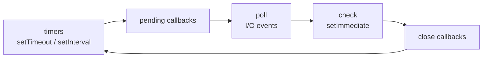

## Modules

```js
// ESM — set "type": "module" in package.json or use .mjs
import { readFile } from "node:fs/promises";
import path from "node:path";
export function helper() {}

// CommonJS — legacy, .cjs
const { readFile } = require("node:fs/promises");
module.exports = { helper };

// ESM equivalents of __dirname
const here = import.meta.dirname;
const file = import.meta.filename;
```

Prefix built-ins with `node:` so they can never be shadowed by an npm package.

## Running and tooling

```bash
node app.js
node --watch app.js                 # restart on change
node --env-file=.env app.js         # load env vars without dotenv
node --test                         # built-in test runner
node --inspect app.js               # attach Chrome DevTools
node --run build                    # run a package.json script (fast)
npx tsx script.ts                   # run TypeScript directly
```

## The event loop



- Between every phase Node drains `process.nextTick` callbacks, then promise microtasks.
- CPU-heavy work on the main thread blocks **all** requests — move it to a worker thread or a queue.

## File system

```js
import { readFile, writeFile, mkdir, readdir, stat, rm } from "node:fs/promises";

const text = await readFile("config.json", "utf8");
const config = JSON.parse(text);
await mkdir("out/reports", { recursive: true });
await writeFile("out/report.txt", "done\n");
const entries = await readdir("src", { withFileTypes: true, recursive: true });
await rm("tmp", { recursive: true, force: true });
```

## Streams

```js
import { createReadStream, createWriteStream } from "node:fs";
import { pipeline } from "node:stream/promises";
import { createGzip } from "node:zlib";

// Constant memory regardless of file size; errors propagate and close every stream
await pipeline(createReadStream("access.log"), createGzip(), createWriteStream("access.log.gz"));

// Async iteration over a readable
for await (const chunk of createReadStream("big.csv", { encoding: "utf8" })) {
  process(chunk);
}
```

<Callout type="tip">
Use `stream/promises` `pipeline` instead of `.pipe()`. Plain `.pipe()` does not forward errors or clean up the other streams.
</Callout>

## HTTP server

```js
import { createServer } from "node:http";

const server = createServer(async (req, res) => {
  const url = new URL(req.url ?? "/", `http://${req.headers.host}`);
  if (req.method === "GET" && url.pathname === "/health") {
    res.writeHead(200, { "content-type": "application/json" });
    return res.end(JSON.stringify({ ok: true }));
  }
  res.writeHead(404).end();
});

server.listen(process.env.PORT ?? 3000);

// Graceful shutdown
process.on("SIGTERM", () => server.close(() => process.exit(0)));
```

Node also ships global `fetch`, `WebSocket`, `AbortController`, `structuredClone` and `crypto.randomUUID()`.

## Events

```js
import { EventEmitter, once } from "node:events";

class Queue extends EventEmitter {}
const q = new Queue();
q.on("job", (job) => console.log("processing", job.id));
q.emit("job", { id: 1 });

const [value] = await once(q, "ready"); // await a single event
```

## Environment and configuration

```js
const port = Number(process.env.PORT ?? 3000);
const isProd = process.env.NODE_ENV === "production";

if (!process.env.DATABASE_URL) {
  throw new Error("DATABASE_URL is required");   // fail fast at startup
}
```

Validate configuration once at startup (for example with Zod) and export a typed object.

## Child processes and workers

```js
import { execFile } from "node:child_process";
import { promisify } from "node:util";
const run = promisify(execFile);
const { stdout } = await run("git", ["rev-parse", "HEAD"]);   // no shell — safe from injection

import { Worker } from "node:worker_threads";
const worker = new Worker(new URL("./hash-worker.js", import.meta.url), { workerData: { file } });
worker.on("message", (digest) => console.log(digest));
```

<Callout type="danger">
Never pass user input to `exec` or `spawn` with `shell: true` — it enables command injection. Use `execFile`/`spawn` with an argument array.
</Callout>

## Error handling

```js
process.on("unhandledRejection", (reason) => {
  console.error("Unhandled rejection", reason);
  process.exit(1);               // crash and let the supervisor restart
});

process.on("uncaughtException", (err) => {
  console.error("Uncaught exception", err);
  process.exit(1);
});
```

## Useful built-ins

| Module | Highlights |
| --- | --- |
| `node:path` | `join`, `resolve`, `extname`, `basename` |
| `node:crypto` | `randomUUID`, `createHash("sha256")`, `timingSafeEqual` |
| `node:util` | `parseArgs`, `promisify`, `inspect`, `styleText` |
| `node:test` | `test`, `describe`, `mock`, coverage |
| `node:timers/promises` | `await setTimeout(1000)` |

## Common mistakes

- **Blocking the event loop** with sync APIs (`readFileSync`, heavy JSON parsing, crypto) in request handlers.
- **Unbounded concurrency** — `Promise.all` over 10,000 requests exhausts sockets; batch or use a limiter.
- **Swallowing errors** in callbacks or unawaited promises.
- **Trusting `x-forwarded-for`** without a trusted proxy in front.
