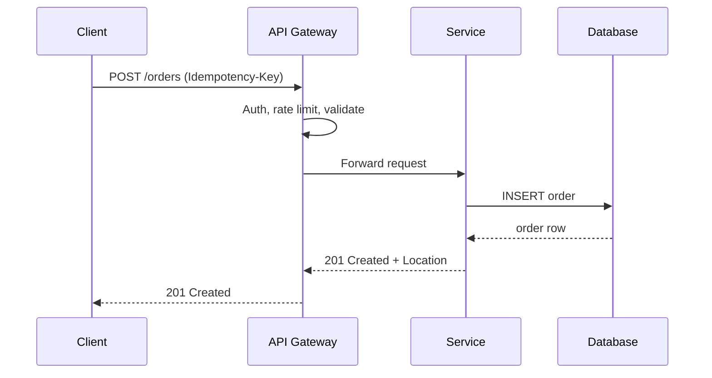

## Resource naming

| Do | Don't |
| --- | --- |
| `GET /users` | `GET /getUsers` |
| `GET /users/42` | `GET /user?id=42` |
| `GET /users/42/orders` | `GET /orders-for-user/42` |
| `POST /orders/9/cancel` (action as sub-resource) | `POST /cancelOrder` |
| `/blog-posts` (kebab-case, plural) | `/BlogPost` |

Nest at most one or two levels; beyond that, use filters: `GET /orders?userId=42`.

## Methods

| Method | Use | Safe | Idempotent | Body |
| --- | --- | --- | --- | --- |
| `GET` | Read | Yes | Yes | No |
| `POST` | Create / trigger action | No | No | Yes |
| `PUT` | Replace entire resource | No | Yes | Yes |
| `PATCH` | Partial update | No | Not guaranteed | Yes |
| `DELETE` | Remove | No | Yes | Optional |
| `HEAD` / `OPTIONS` | Metadata / CORS preflight | Yes | Yes | No |

## Status codes

| Code | When |
| --- | --- |
| `200 OK` | Successful read or update with a body |
| `201 Created` | Resource created — include a `Location` header |
| `202 Accepted` | Async work queued |
| `204 No Content` | Success with no body (DELETE, some PUTs) |
| `301` / `308` | Permanent redirect (`308` keeps the method) |
| `304 Not Modified` | Conditional GET matched the ETag |
| `400 Bad Request` | Malformed syntax |
| `401 Unauthorized` | Missing or invalid credentials |
| `403 Forbidden` | Authenticated but not allowed |
| `404 Not Found` | Resource doesn't exist (or is hidden) |
| `409 Conflict` | State conflict, duplicate, version mismatch |
| `422 Unprocessable Content` | Valid syntax, failed validation |
| `429 Too Many Requests` | Rate limited — include `Retry-After` |
| `500` / `503` | Server error / temporarily unavailable |

## Request lifecycle



## Errors

Use one consistent shape. RFC 9457 Problem Details is a good default:

```json
{
  "type": "https://api.example.com/errors/validation",
  "title": "Validation failed",
  "status": 422,
  "detail": "2 fields are invalid",
  "errors": [
    { "field": "email", "message": "must be a valid email" },
    { "field": "age", "message": "must be >= 18" }
  ]
}
```

Never leak stack traces, SQL, or internal hostnames in error responses.

## Pagination

```http
GET /orders?limit=50&cursor=eyJpZCI6MTIzfQ
```

```json
{
  "data": [ /* … */ ],
  "pagination": { "nextCursor": "eyJpZCI6MTczfQ", "hasMore": true }
}
```

| Strategy | Pros | Cons |
| --- | --- | --- |
| Offset (`?page=3&limit=20`) | Simple, jump to page | Slow on deep pages, duplicates when data shifts |
| Cursor / keyset (`?cursor=…`) | Fast, stable under writes | No random access |

## Filtering, sorting, fields

```http
GET /products?category=books&price[lte]=30&sort=-createdAt,name&fields=id,name,price
```

Allow-list filterable and sortable fields on the server; never pass them straight into SQL.

## Versioning

| Approach | Example |
| --- | --- |
| URL path (most common) | `/v1/users` |
| Header | `Accept: application/vnd.example.v2+json` |

Additive changes (new fields, new endpoints) are non-breaking. Removing or renaming fields, changing types, or tightening validation requires a new version.

## Idempotency

```http
POST /payments
Idempotency-Key: 7f3c1b6e-1a2b-4c8d-9e0f-123456789abc
```

Store the key with the response; replay the stored response for retries with the same key. Essential for payments and any POST that clients retry.

## Caching and concurrency

```http
GET /articles/7
→ 200 OK
  ETag: "a1b2c3"
  Cache-Control: private, max-age=60

GET /articles/7
If-None-Match: "a1b2c3"
→ 304 Not Modified

PUT /articles/7
If-Match: "a1b2c3"          # optimistic locking
→ 412 Precondition Failed    # if someone else updated it first
```

## Security checklist

<Steps>
<Step title="Authenticate every request">
Use OAuth 2.0 / OIDC bearer tokens or signed session cookies. Never put credentials in query strings.
</Step>
<Step title="Authorise at the object level">
Check that the caller owns `/orders/42`, not just that they are logged in (prevents IDOR).
</Step>
<Step title="Validate input strictly">
Schema-validate bodies, reject unknown fields, cap sizes, and paginate everything.
</Step>
<Step title="Rate limit and log">
Limit by user and IP, return `429`, and keep audit logs for writes.
</Step>
</Steps>

## Common mistakes

- **`200` with an error body** — clients and monitoring can't detect failures.
- **Verbs in URLs** (`/createUser`) instead of methods on resources.
- **Unbounded list endpoints** — always paginate with a maximum `limit`.
- **Returning internal database IDs and fields** you can never change — design the public representation deliberately.
