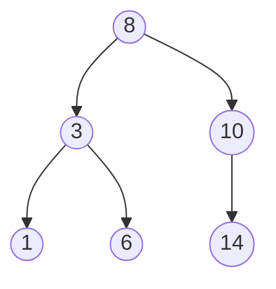

## Choosing a structure

| Need | Use |
| --- | --- |
| Index by position, iterate in order | Array / dynamic array |
| Fast lookup by key | Hash map |
| Unique membership checks | Hash set |
| Last-in, first-out (undo, DFS, parsing) | Stack |
| First-in, first-out (BFS, task queues) | Queue / deque |
| Repeatedly take min or max | Heap (priority queue) |
| Sorted data with range queries | Balanced BST / sorted array + binary search |
| Prefix search, autocomplete | Trie |
| Relationships, networks, dependencies | Graph |
| Grouping / connectivity | Union-find (disjoint set) |

## Arrays and dynamic arrays

- Contiguous memory: `O(1)` index access and cache-friendly iteration.
- Insert/delete in the middle shifts elements: `O(n)`.
- Dynamic arrays (JS `Array`, Python `list`, Go slices) grow by doubling capacity — amortised `O(1)` append.

```ts
// Two pointers: is a sorted array a pair-sum match?
function hasPairWithSum(nums: number[], target: number): boolean {
  let lo = 0, hi = nums.length - 1;
  while (lo < hi) {
    const sum = nums[lo] + nums[hi];
    if (sum === target) return true;
    if (sum < target) lo++;
    else hi--;
  }
  return false;
}
```

## Linked lists

```ts
class ListNode<T> {
  constructor(public value: T, public next: ListNode<T> | null = null) {}
}

function reverse<T>(head: ListNode<T> | null): ListNode<T> | null {
  let prev: ListNode<T> | null = null;
  while (head) {
    const next = head.next;
    head.next = prev;
    prev = head;
    head = next;
  }
  return prev;
}
```

`O(1)` insert/delete when you hold the node, `O(n)` access. Used for LRU caches (with a hash map) and when you splice often. Slow/fast pointers detect cycles and find midpoints.

## Stacks and queues

```python
stack = []
stack.append(1); stack.append(2); stack.pop()   # 2

from collections import deque
queue = deque()
queue.append("a"); queue.append("b"); queue.popleft()   # "a" — O(1)
```

<Callout type="warning">
`list.pop(0)` in Python and `array.shift()` in JavaScript are `O(n)`. Use `collections.deque` or a ring buffer for queues.
</Callout>

## Hash maps and sets

```ts
// Frequency count — O(n)
const counts = new Map<string, number>();
for (const word of words) counts.set(word, (counts.get(word) ?? 0) + 1);

// Two-sum in one pass
function twoSum(nums: number[], target: number): [number, number] | null {
  const seen = new Map<number, number>();
  for (let i = 0; i < nums.length; i++) {
    const j = seen.get(target - nums[i]);
    if (j !== undefined) return [j, i];
    seen.set(nums[i], i);
  }
  return null;
}
```

Average `O(1)` insert/lookup/delete; no ordering (except insertion order in JS `Map` and Python `dict`).

## Trees



| Traversal | Order | Typical use |
| --- | --- | --- |
| In-order | left, node, right | Sorted output from a BST |
| Pre-order | node, left, right | Copy/serialise a tree |
| Post-order | left, right, node | Delete, evaluate expressions |
| Level-order (BFS) | Row by row | Shortest path in unweighted trees |

```ts
type TreeNode = { val: number; left: TreeNode | null; right: TreeNode | null };

function maxDepth(root: TreeNode | null): number {
  return root ? 1 + Math.max(maxDepth(root.left), maxDepth(root.right)) : 0;
}
```

A binary search tree keeps `left` values smaller than the node and `right` values larger. Balanced variants (AVL, red-black, B-trees in databases) guarantee `O(log n)` height.

## Heaps (priority queues)

```python
import heapq

nums = [5, 1, 8, 3]
heapq.heapify(nums)            # O(n), min-heap
heapq.heappush(nums, 2)        # O(log n)
smallest = heapq.heappop(nums) # O(log n)
top3 = heapq.nlargest(3, nums)

# Max-heap: push negated values, or (priority, item) tuples
```

Use for top-K, scheduling, merging K sorted lists, and Dijkstra's algorithm.

## Tries

```ts
class TrieNode {
  children = new Map<string, TrieNode>();
  end = false;
}

class Trie {
  root = new TrieNode();
  insert(word: string) {
    let node = this.root;
    for (const ch of word) {
      if (!node.children.has(ch)) node.children.set(ch, new TrieNode());
      node = node.children.get(ch)!;
    }
    node.end = true;
  }
  startsWith(prefix: string): boolean {
    let node: TrieNode | undefined = this.root;
    for (const ch of prefix) node = node?.children.get(ch);
    return node !== undefined;
  }
}
```

## Graphs

| Representation | Space | Edge check | Best for |
| --- | --- | --- | --- |
| Adjacency list | `O(V + E)` | `O(degree)` | Sparse graphs (most real ones) |
| Adjacency matrix | `O(V²)` | `O(1)` | Dense graphs, small V |

```python
from collections import deque

def bfs(graph: dict[str, list[str]], start: str) -> dict[str, int]:
    dist = {start: 0}
    queue = deque([start])
    while queue:
        node = queue.popleft()
        for nxt in graph[node]:
            if nxt not in dist:
                dist[nxt] = dist[node] + 1
                queue.append(nxt)
    return dist          # shortest hop counts in an unweighted graph
```

## Union-find

```python
parent = list(range(n))

def find(x):
    while parent[x] != x:
        parent[x] = parent[parent[x]]   # path compression
        x = parent[x]
    return x

def union(a, b):
    parent[find(a)] = find(b)
```

## Common mistakes

- **Using a list for membership tests** inside a loop — switch to a set.
- **Recursion depth limits** on deep trees or long lists — use an explicit stack.
- **Forgetting visited sets** in graph traversal — infinite loops on cycles.
- **Mutable keys** in hash maps — keys must be immutable/hashable.
