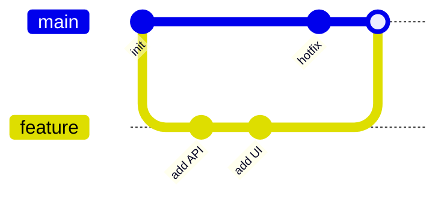

## Setup

```bash
git config --global user.name "Ada Lovelace"
git config --global user.email "ada@example.com"
git config --global init.defaultBranch main
git config --global pull.rebase true          # rebase instead of merge on pull
git config --global rebase.autoStash true
git config --global push.autoSetupRemote true # first push sets upstream
```

## Daily workflow

```bash
git status -sb                 # short status with branch
git switch -c feat/search      # create and switch branch
git add -p                     # stage hunks interactively
git commit -m "feat: add search overlay"
git push
git pull                       # fetch + rebase (with config above)
git switch main
```

When staging with `git add -p`, press <Kbd>y</Kbd> to stage a hunk, <Kbd>n</Kbd> to skip it, <Kbd>s</Kbd> to split it, <Kbd>e</Kbd> to edit it, and <Kbd>q</Kbd> to quit.

## The three areas

| Area | Contains | Move to next with |
| --- | --- | --- |
| Working tree | Your edited files | `git add` |
| Index (staging) | The next commit | `git commit` |
| Repository | Committed history | `git push` (to remote) |

## Branching and merging



```bash
git branch -vv                 # branches with upstream info
git merge feature              # merge commit (or fast-forward)
git merge --squash feature     # one combined change, you commit it
git branch -d feature          # delete merged branch
git push origin --delete feature
```

## Rebase

```bash
git fetch origin
git rebase origin/main                 # replay your commits on top of main
git rebase --continue                  # after resolving conflicts
git rebase --abort                     # back to before the rebase
git commit --fixup <sha>               # mark a fix for an earlier commit
git rebase --autosquash origin/main    # fold fixups into their targets
git push --force-with-lease            # safe force push after rebasing
```

<Callout type="danger">
Never rebase commits that others have already based work on (shared branches like `main`). Use `--force-with-lease`, not `--force`, so you don't overwrite a teammate's push.
</Callout>

## Undoing things

| Situation | Command |
| --- | --- |
| Discard unstaged changes in a file | `git restore file` |
| Unstage a file (keep changes) | `git restore --staged file` |
| Fix the last commit message or add files | `git commit --amend` |
| Undo last commit, keep changes staged | `git reset --soft HEAD~1` |
| Undo last commit, keep changes unstaged | `git reset HEAD~1` |
| Throw away last commit and changes | `git reset --hard HEAD~1` |
| Undo a pushed commit safely | `git revert <sha>` |
| Recover "lost" commits | `git reflog`, then `git switch -c rescue <sha>` |
| Remove untracked files | `git clean -fd` (preview with `-n`) |

## Stash

```bash
git stash push -m "wip: search"       # save changes
git stash push -u                     # include untracked files
git stash list
git stash pop                         # apply and drop latest
git stash apply stash@{1}             # apply without dropping
git stash drop stash@{1}
```

## History and search

```bash
git log --oneline --graph --decorate --all
git log -p -- path/to/file            # patches for one file
git log -S "functionName"             # commits that added/removed a string
git log --since="2 weeks ago" --author="Ada"
git blame -w -C file.ts               # ignore whitespace, detect moves
git show <sha>
git diff main...feature               # changes since branches diverged
git bisect start; git bisect bad; git bisect good v1.2.0   # binary search for a bug
```

## Remotes

```bash
git remote -v
git remote add upstream https://github.com/org/repo.git
git fetch --all --prune
git switch -c fix origin/fix          # track a remote branch
git push -u origin feat/search
```

## Tags

```bash
git tag -a v1.4.0 -m "Release 1.4.0"
git push origin v1.4.0
git tag --list "v1.*"
```

## Commit messages (Conventional Commits)

```text
feat(search): add keyboard navigation to results

Explain *why* the change was made, not what the diff already shows.

Closes #128
```

Types: `feat`, `fix`, `docs`, `refactor`, `perf`, `test`, `build`, `ci`, `chore`.

## Useful aliases

```bash
git config --global alias.lg "log --oneline --graph --decorate"
git config --global alias.undo "reset --soft HEAD~1"
git config --global alias.st "status -sb"
```

## Common mistakes

- **Committing secrets** — rotate them immediately; rewriting history is not enough once pushed.
- **Giant commits** mixing refactors and features — commit in small logical steps.
- **`git add .` without reviewing** — use `git add -p` or check `git diff --staged`.
- **Long-lived branches** — rebase or merge `main` often to keep conflicts small.
