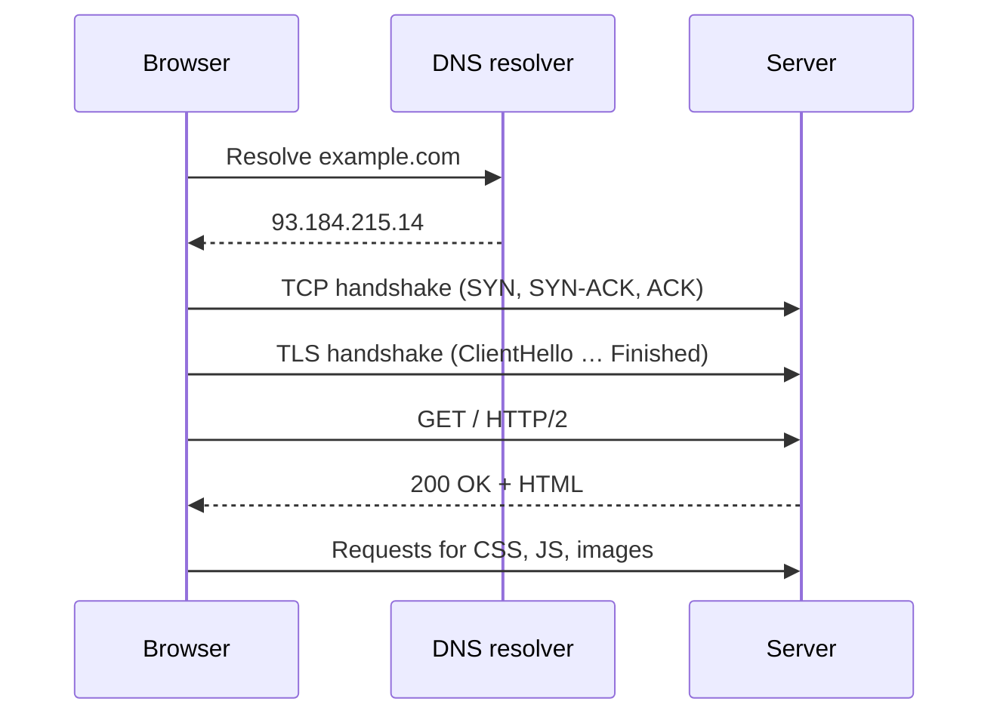

## What happens when you open a URL



## Network layers (simplified)

| Layer | Protocols | Unit |
| --- | --- | --- |
| Application | HTTP, DNS, SMTP, SSH, WebSocket | Message |
| Transport | TCP, UDP, QUIC | Segment / datagram |
| Internet | IP (v4, v6), ICMP | Packet |
| Link | Ethernet, Wi-Fi | Frame |

## TCP vs UDP

| | TCP | UDP |
| --- | --- | --- |
| Connection | Handshake first | Connectionless |
| Delivery | Reliable, ordered, retransmits | Best effort |
| Flow/congestion control | Yes | No (app decides) |
| Uses | HTTP/1.1, HTTP/2, databases, SSH | DNS, video calls, games, QUIC (HTTP/3) |

## DNS

| Record | Maps |
| --- | --- |
| `A` / `AAAA` | Name → IPv4 / IPv6 address |
| `CNAME` | Name → another name (alias) |
| `MX` | Domain → mail servers |
| `TXT` | Arbitrary text (SPF, DKIM, domain verification) |
| `NS` | Domain → authoritative name servers |
| `CAA` | Which CAs may issue certificates |

TTL controls how long resolvers cache a record — lower it ahead of a migration.

## HTTP versions

| | HTTP/1.1 | HTTP/2 | HTTP/3 |
| --- | --- | --- | --- |
| Transport | TCP | TCP | QUIC (UDP) |
| Multiplexing | No (one request per connection at a time) | Yes, streams over one connection | Yes, without TCP head-of-line blocking |
| Headers | Plain text | Compressed (HPACK) | Compressed (QPACK) |
| Connection setup | TCP + TLS | TCP + TLS | Combined, 0-RTT resumption possible |

## Anatomy of a request

```http
POST /api/orders HTTP/1.1
Host: shop.example.com
Content-Type: application/json
Authorization: Bearer eyJhbGciOi...
Accept: application/json
Content-Length: 39

{"productId": "sku-42", "quantity": 2}
```

```http
HTTP/1.1 201 Created
Content-Type: application/json
Location: /api/orders/981
Cache-Control: no-store

{"id": 981, "status": "pending"}
```

## Headers worth knowing

| Header | Purpose |
| --- | --- |
| `Cache-Control` | Caching policy: `no-store`, `private, max-age=60`, `public, s-maxage=600, stale-while-revalidate=60` |
| `ETag` / `If-None-Match` | Conditional requests → `304 Not Modified` |
| `Content-Type` / `Accept` | Body format sent / wanted |
| `Content-Encoding` | `br`, `gzip`, `zstd` compression |
| `Authorization` | Credentials (`Bearer`, `Basic`) |
| `Set-Cookie` | `HttpOnly; Secure; SameSite=Lax; Path=/` |
| `Strict-Transport-Security` | Force HTTPS for future visits |
| `Retry-After` | When to retry after `429` or `503` |

## TLS in one minute

- The server proves its identity with a certificate signed by a trusted CA.
- Client and server agree on keys (ECDHE) so that traffic is encrypted with forward secrecy.
- TLS 1.3 completes the handshake in one round trip.
- Use automated certificates (ACME / Let's Encrypt) and redirect all HTTP to HTTPS.

## CORS

Browsers block cross-origin reads unless the server opts in. Non-simple requests (custom headers, JSON bodies, `PUT`/`DELETE`) trigger a preflight:

```http
OPTIONS /api/orders HTTP/1.1
Origin: https://app.example.com
Access-Control-Request-Method: POST
Access-Control-Request-Headers: content-type, authorization
```

```http
HTTP/1.1 204 No Content
Access-Control-Allow-Origin: https://app.example.com
Access-Control-Allow-Methods: GET, POST
Access-Control-Allow-Headers: content-type, authorization
Access-Control-Allow-Credentials: true
Access-Control-Max-Age: 600
Vary: Origin
```

<Callout type="warning">
CORS protects users' browsers, not your API. It does nothing against curl or server-to-server calls — you still need authentication. Never reflect arbitrary origins together with `Allow-Credentials: true`.
</Callout>

## Real-time options

| Technique | Direction | Notes |
| --- | --- | --- |
| Polling | Client → server | Simple, wasteful |
| Server-Sent Events | Server → client | HTTP, auto-reconnect, text only |
| WebSocket | Bidirectional | Persistent connection, needs sticky routing |
| WebTransport | Bidirectional | Over HTTP/3, newer |

## Debugging toolkit

```bash
curl -i https://api.example.com/health                  # include response headers
curl -sS -o /dev/null -w "%{http_code} %{time_total}s\n" https://example.com
curl -v --http2 https://example.com                     # verbose, force HTTP/2
curl -X POST -H "content-type: application/json" -d '{"a":1}' https://httpbin.org/post

dig example.com A +short                                # DNS lookup
dig example.com @1.1.1.1 MX                             # query a specific resolver
nslookup example.com
openssl s_client -connect example.com:443 -servername example.com   # inspect TLS cert
nc -zv db.internal 5432                                 # is a port reachable?
traceroute example.com                                  # path and hop latency
ss -tlnp                                                # listening sockets (Linux)
```

## Common mistakes

- **Forgetting `Vary`** when responses differ by `Origin`, `Accept-Encoding` or cookies — caches serve the wrong variant.
- **Caching authenticated responses publicly** — use `private` or `no-store`.
- **Long DNS TTLs during migrations** — users keep hitting the old servers.
- **Ignoring timeouts** on outbound HTTP calls.
