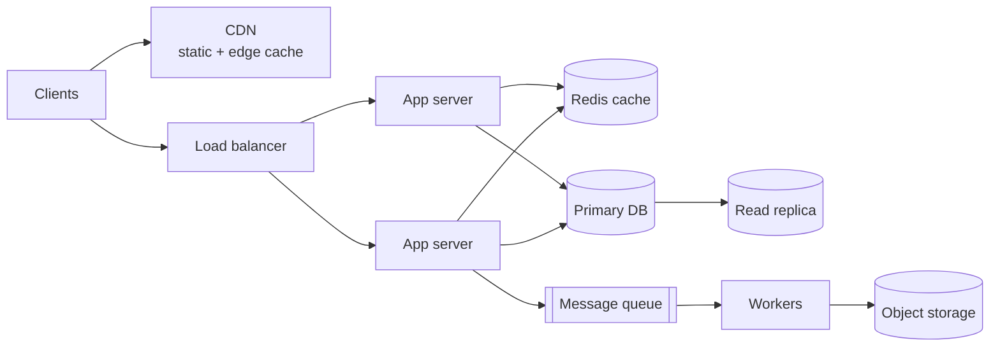

## A repeatable approach

<Steps>
<Step title="Clarify requirements">
Functional (what users do) and non-functional (latency, availability, consistency, scale, cost). Agree on what is out of scope.
</Step>
<Step title="Estimate scale">
Requests per second, read/write ratio, storage per year, bandwidth. These numbers drive every later decision.
</Step>
<Step title="Define the API and data model">
List endpoints or events and the core entities with their access patterns.
</Step>
<Step title="Sketch the high-level design">
Clients, load balancer, services, data stores, caches, queues.
</Step>
<Step title="Deep-dive and handle failure">
Bottlenecks, hot keys, single points of failure, retries, monitoring.
</Step>
</Steps>

## Back-of-the-envelope numbers

| Quantity | Approximate value |
| --- | --- |
| Seconds per day | ≈86,400 (use 10⁵) |
| 1M requests/day | ≈12 requests/second |
| L1 cache / RAM reference | ≈1 ns / ≈100 ns |
| SSD random read | ≈100 µs |
| Same-region round trip | ≈0.5–1 ms |
| Cross-continent round trip | ≈100–150 ms |
| Read 1 MB sequentially from RAM / SSD | ≈5 µs / ≈200 µs |

Example: 100M daily users × 10 reads ≈ 10⁹ reads/day ≈ 12k reads/s average, plan for 2–3× peaks.

## Reference architecture

## Scaling

| Approach | Pros | Cons |
| --- | --- | --- |
| Vertical (bigger machine) | Simple, no code changes | Hard ceiling, single point of failure |
| Horizontal (more machines) | Near-linear scale, redundancy | Needs stateless services, load balancing |

Keep application servers **stateless** — store sessions in a shared store or signed tokens — so any instance can serve any request.

## Load balancing

| Algorithm | Behaviour |
| --- | --- |
| Round robin | Rotate through servers |
| Least connections | Send to the least-busy server |
| Consistent hashing | Same key → same server; minimal remapping when nodes change |

Layer 4 balancers route TCP/UDP; layer 7 balancers understand HTTP (paths, headers, TLS termination).

## Caching

| Strategy | How it works | Watch out for |
| --- | --- | --- |
| Cache-aside | App reads cache, falls back to DB, then fills cache | Stale data until TTL/invalidation |
| Write-through | Write cache and DB together | Higher write latency |
| Write-behind | Write cache, flush to DB asynchronously | Data loss on crash |
| CDN / edge | Cache responses near users | Purging, personalised content |

<Callout type="warning">
Plan for **cache stampedes**: when a hot key expires, thousands of requests hit the database at once. Use request coalescing, jittered TTLs, or serve-stale-while-revalidate.
</Callout>

## Databases

| Choice | Strengths | Typical use |
| --- | --- | --- |
| Relational (PostgreSQL, MySQL) | Transactions, joins, constraints | Most business data |
| Key-value (Redis, DynamoDB) | Very fast lookups by key | Sessions, caches, counters |
| Document (MongoDB) | Flexible schemas | Content, catalogs |
| Wide-column (Cassandra) | Massive write throughput | Time series, logs |
| Search (Elasticsearch, OpenSearch) | Full-text and faceted search | Search, log analytics |
| Object storage (S3) | Cheap, durable blobs | Files, backups, data lakes |

- **Replication:** primary handles writes, replicas serve reads (expect replication lag).
- **Partitioning/sharding:** split data by key (user ID, tenant). Pick a key that spreads load evenly and keeps related data together.
- **Indexes** speed reads and slow writes — index for your actual query patterns.

## Consistency and CAP

During a network partition a distributed system must choose between **consistency** (every read sees the latest write) and **availability** (every request gets a response).

| Model | Guarantee | Example |
| --- | --- | --- |
| Strong | Reads always see the latest write | Bank balances |
| Read-your-writes | A user sees their own updates | Profile edits |
| Eventual | Replicas converge over time | Like counts, feeds |

## Asynchronous processing

- **Queues** (SQS, RabbitMQ) decouple producers and consumers and absorb spikes.
- **Logs/streams** (Kafka) keep an ordered, replayable history for many consumers.
- Design consumers to be **idempotent** — most systems deliver at-least-once.
- Use **dead-letter queues** for messages that keep failing.

## Reliability patterns

| Pattern | Purpose |
| --- | --- |
| Timeouts everywhere | Never wait forever on a dependency |
| Retries with exponential backoff + jitter | Recover from transient failures without thundering herds |
| Circuit breaker | Stop calling a failing dependency |
| Rate limiting (token bucket) | Protect services from overload and abuse |
| Bulkheads | Isolate resources so one failure doesn't sink everything |
| Health checks + autoscaling | Replace bad instances, follow load |

## Observability

Track the **four golden signals** — latency, traffic, errors, saturation — with metrics, structured logs, and distributed traces. Define SLOs (for example 99.9% of requests under 300 ms) and alert on burn rate, not on every blip.

## Common mistakes

- **Designing for Google scale** when requirements say 100 requests per second.
- **A single database** as an unacknowledged single point of failure.
- **Ignoring hot keys** — one celebrity user or viral item can overload a shard.
- **Synchronous chains** of many services — latency and failure probabilities multiply.
